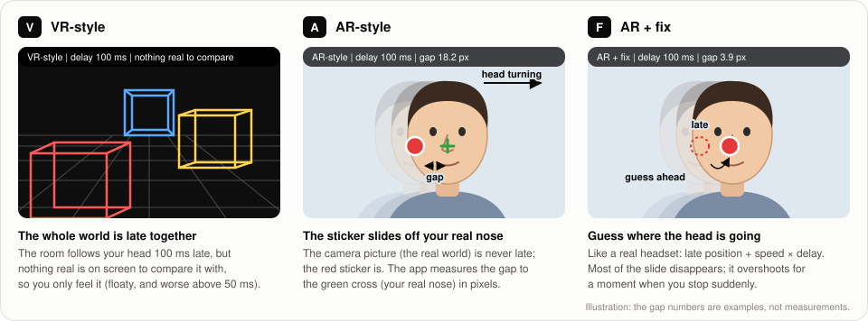
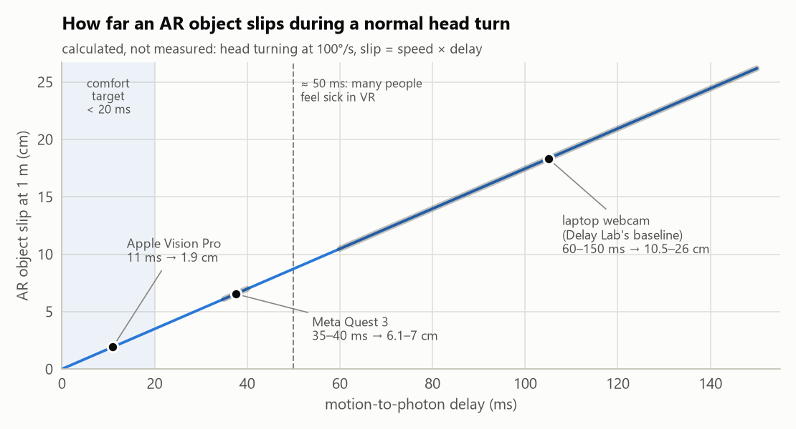
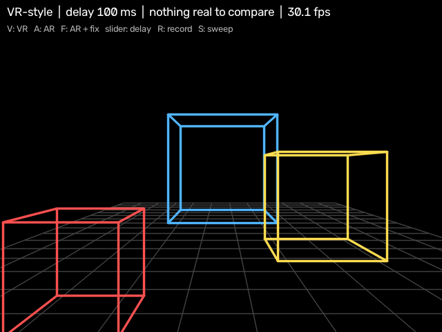
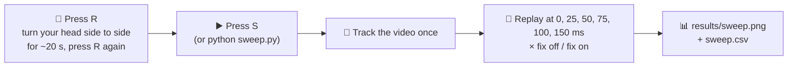
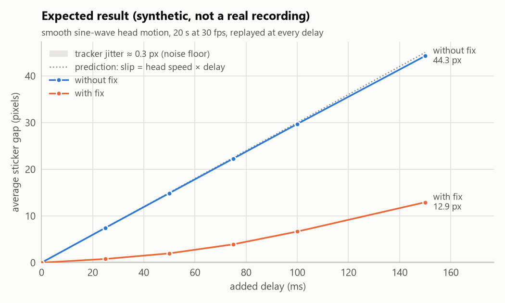
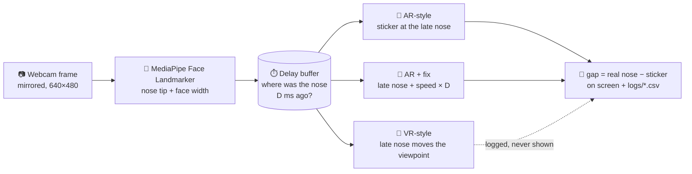
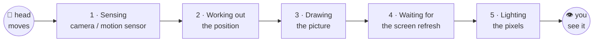

<h1 align="center">Delay Lab</h1>

<p align="center">
  <b>See why AR punishes headset delay more than VR, on an ordinary laptop webcam.</b>
</p>

<p align="center">
  <a href="https://github.com/06pratyush/delay_lab/actions/workflows/tests.yml"></a>
  
  
  
  
  
  
</p>

<p align="center">
  
</p>

> [!TIP]
> **No headset needed.** A laptop with a webcam is enough. Pick a delay with the slider,
> switch between <kbd>V</kbd> VR-style, <kbd>A</kbd> AR-style and <kbd>F</kbd> AR + fix, and watch the difference.

**Contents:** [The idea](#-the-idea-in-30-seconds) · [Quick start](#-quick-start) · [Controls](#-controls) · [What you see](#-what-you-see) · [The experiment](#-the-experiment) · [How it works](#%EF%B8%8F-how-it-works) · [Real numbers](#-real-world-numbers) · [Presenting](#-presenting-it) · [DelayLab.exe](#-delaylabexe) · [Help](#-troubleshooting)

---

## 💡 The idea in 30 seconds

1. **Every headset is a little late.** When you move your head, the picture catches up a few milliseconds afterwards.
2. **In VR you can't *see* it.** The whole fake world is late *together*, so there's nothing to compare against. You only *feel* it, as floatiness or, above about 50 ms, as sickness.
3. **In AR you can.** The real world is never late, so a virtual object visibly **slides off** the real thing it was stuck to.

Delay Lab adds a chosen delay to webcam face tracking, shows it both ways, **measures the slide in pixels**,
and then switches on the fix real headsets use (**prediction**) to show how much of the slide disappears.

<p align="center">
  
</p>

> **slip = head speed × delay.** At a normal 100°/s head turn, 20 ms of delay moves an AR object
> 1 m away by about **3.5 cm**. That's easy to spot on a cup on a table.

---

## 🚀 Quick start

You need **Windows 10/11, a webcam and Python 3.11**. MediaPipe can lag behind newer Python releases.

```bash
py -3.11 -m venv .venv && .venv\Scripts\activate
pip install -r requirements.txt
python download_model.py        # one-time, ~4 MB face model
python app.py
```

<details>
<summary><b>Check that everything works (self-test)</b></summary>

```bash
python app.py --selftest 8
```

The app drives itself: AR at 0 and 100 ms, AR + fix, VR, a short recording and a sweep. Then it prints
the frames per second, how often a face was found, and the gap in each mode. Expect about **25–30 fps**
and a face in close to 100% of frames. Use `--camera 1` if you have more than one webcam.
</details>

Prefer no Python at all? See [**DelayLab.exe**](#-delaylabexe).

---

## 🎮 Controls

| Key | Mode / action | What happens |
|:---:|---|---|
| <kbd>V</kbd> | **VR-style** | Camera hidden. A wireframe room moves with your (delayed) head. |
| <kbd>A</kbd> | **AR-style** | Your live face, with a 🔴 sticker drawn at the *delayed* nose position. A 🟢 cross marks your real nose. |
| <kbd>F</kbd> | **AR + fix** | Same as AR, but the sticker is drawn where your head is *predicted* to be. |
| slider | **delay** | Extra delay added on top of the camera's own: 0–150 ms. |
| <kbd>R</kbd> | record | Start or stop recording. Saves `head_*.mp4` (raw camera, for the sweep) and `demo_*.mp4` (what the window shows). |
| <kbd>S</kbd> | sweep | Replays the newest recording at every delay, without and with the fix, and saves a chart. |
| <kbd>W</kbd> | fullscreen | Toggles fullscreen. The window can also be dragged to any size for a projector. |
| <kbd>Q</kbd> / <kbd>Esc</kbd> | quit | |

---

## 👀 What you see

<table>
<tr>
<td width="52%"></td>
<td>

**VR-style** (<kbd>V</kbd>) is a real screenshot of the app. Lean left and the near red box slides
further than the far blue one, like looking through a window. At 100 ms the room follows
you late, yet nothing looks *wrong*.

**The strip at the top** shows, from left to right:

| | |
|---|---|
| mode | VR-style / AR-style / AR + fix |
| delay | the slider value |
| **gap** | 🔴 sticker → 🟢 real nose, in pixels (AR modes only) |
| fps | frames per second (aim for 25+) |

</td>
</tr>
</table>

---

## 🔬 The experiment

One automatic measurement carries the result. It uses a **recording**, so every delay sees exactly the same
head motion and the chart comes out identical on every run.



<p align="center">
  
</p>

This chart is the **expected shape**, computed from a synthetic head track. Your own `results/sweep.png` replaces it.

| What you should see | What it means |
|---|---|
| 🔵 **Without fix:** a near-straight line on the dotted prediction | The error really is *head speed × delay* |
| 🟠 **With fix:** several times smaller, but not zero | Prediction works; it overshoots when the head stops or turns back |
| ▒ **Grey band:** tracker jitter, well under 1 px | The noise floor. The delay effect is far above it |
| ❌ **A clearly bent line, or a fix that doesn't help** | Would prove us wrong: tracker jitter beats the delay effect |

> [!NOTE]
> A first real run on a 2.5 s self-test clip already showed this pattern: a straight line on the prediction
> (12.5 px at 100 ms), the fix about 3× smaller (4.4 px), and jitter of only 0.4 px.

---

## ⚙️ How it works

Every camera frame, about 30 times a second:



- **Delay buffer:** every nose position is saved with its time. To draw, the app asks "where was the nose
  *D* ms ago?" and blends the two saved positions either side of that moment.
- **The fix:** it uses only old data, as a real headset must. It takes the speed from the last two late
  positions and draws at *late position + speed × D*.
- **Fair from the start:** the camera image and the face dots come from the *same* frame. At 0 ms the sticker sits
  exactly on your nose, so every gap measured comes only from the delay Delay Lab adds.

<details>
<summary><b>Files in this repo</b></summary>

| File | Role |
|------|------|
| `app.py` | Window, slider, keys, modes, per-frame CSV log, recorder, `--selftest` |
| `tracker.py` | MediaPipe Face Landmarker wrapper (VIDEO mode) |
| `delay.py` | Time-stamped look-back buffer and the guess-ahead fix |
| `render.py` | Sticker, text strip, wireframe room (pinhole projection, no 3D engine) |
| `sweep.py` | Recorded video → every delay × fix → CSV + chart, with the noise floor |
| `make_gif.py` | Demo recording → README GIF |
| `chart_style.py` | Shared colours and styling for every chart |
| `paths.py` | Where the model and output folders live (from source or inside the exe) |
| `build_exe.py` | PyInstaller → `dist/DelayLab.exe` |
| `docs/make_figures.py` | Regenerates the images in `docs/img/` |
| `tests/` | `python -m pytest`: 26 tests, no webcam needed |

</details>

---

## 📏 Real-world numbers

Delay builds up along the whole path from **motion to photon** (from your movement to the light that shows it):



| System | Motion-to-photon delay | AR slip at 1 m (100°/s turn) |
|---|---:|---:|
| 🎯 Comfortable VR target (3GPP TR 26.918) | < ~20 ms | < 3.5 cm |
| Apple Vision Pro passthrough (Optofidelity) | ~11 ms | ~1.9 cm |
| Meta Quest 3 / Quest Pro / HTC Vive XR Elite | ~35–40 ms | ~6–7 cm |
| 💻 A laptop webcam pipeline | ~60–150 ms ([measure yours](docs/MEASURE_WEBCAM_DELAY.md)) | ~10–26 cm |

Headsets fight delay three ways: **faster parts**, **prediction** (Delay Lab's <kbd>F</kbd> mode), and
**last-moment correction** ("timewarp"), which shifts the finished picture just before it's shown.

---

## 🎤 Presenting it

[**docs/DEMO_SCRIPT.md**](docs/DEMO_SCRIPT.md) is a five-minute demo: 1 show the problem → 2 why VR hides it →
3 the measurement → 4 the fix and its overshoot → 5 the link to real headsets.

<details>
<summary><b>Make a GIF of your own demo</b></summary>

Press <kbd>R</kbd>, show the sticker sliding at 100 ms, switch to <kbd>F</kbd>, then press <kbd>R</kbd> again. Then run:

```bash
python make_gif.py --start 2 --seconds 6     # newest demo_*.mp4 → results/demo.gif
```

The GIF shows your face, so it stays in `results/` (not committed) unless you choose to move it to
`docs/` and add it here.
</details>

---

## 📦 DelayLab.exe

One file that runs on a Windows PC **without Python installed**:

```bash
pip install -r requirements-build.txt
python build_exe.py                 # → dist/DelayLab.exe (~130 MB, face model included)
dist\DelayLab.exe --selftest 8      # same self-check as above
```

`logs/`, `recordings/` and `results/` are created next to the exe. The first start takes a few seconds while it unpacks.

---

## 🛠 Troubleshooting

<details>
<summary><b>"no face" in the strip</b></summary>

Light your face from the front, sit 40–80 cm from the camera, and avoid a bright window behind you.
</details>

<details>
<summary><b>Below about 20 fps</b></summary>

Close other apps that use the CPU or the camera. Jerky tracking hides the effect. The camera already runs at 640×480.
</details>

<details>
<summary><b>The fix looks <i>worse</i> than no fix</b></summary>

Prediction multiplies small tracker jitter when you sit still, and overshoots on jerky motion. Turn your head
**smoothly** for the sweep recording. The overshoot when you stop is real, and worth showing (demo step 4).
</details>

<details>
<summary><b>Wrong camera, or "Could not read from camera"</b></summary>

Close other apps using the webcam, or try `python app.py --camera 1` (or 2, …).
</details>

---

## 🧪 Development

```bash
python -m pytest                 # 26 tests on synthetic head tracks: no webcam needed
python docs/make_figures.py      # rebuild the charts and screenshot in docs/img/
```

CI runs the tests on Windows with Python 3.11 on every push.

## License

MIT. See [LICENSE](LICENSE).
