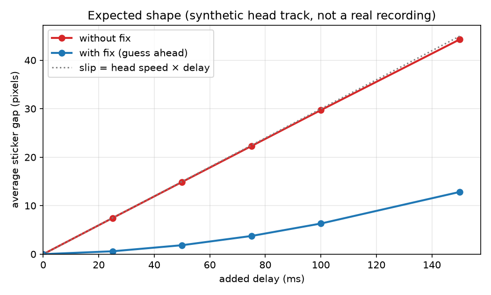

# Delay Lab

**See why AR punishes headset delay more than VR, on an ordinary laptop webcam.**

Every headset is a little late. When you move your head, the picture catches up a few
milliseconds afterwards. In VR the whole fake world is late together, so you only *feel* it.
In AR the real world is never late, so virtual objects visibly slide off the things they
were stuck to.

Delay Lab adds a chosen delay (0–150 ms) to webcam face tracking and shows that same
delay two ways. Then it switches on the fix real headsets use (prediction) and measures
how much of the slide disappears.

| Key | Mode | What you see |
|-----|------|--------------|
| `V` | **VR-style** | Camera hidden. A wireframe room moves with your (delayed) head. |
| `A` | **AR-style** | Your live face, with a red sticker at the *delayed* nose position. A green cross marks the real nose. |
| `F` | **AR + fix** | Same, but the sticker is drawn where your head is *predicted* to be. |
| `R` | record | Start/stop recording a head-movement video for the sweep. |
| `S` | sweep | Replay the newest recording at every delay, with and without the fix → CSV + chart. |
| `Q` / `Esc` | quit | |

The slider sets the added delay. The strip at the top shows the mode, the delay, the live
**gap in pixels** between the sticker and your real nose, and the frames per second.

## Setup (Windows, Python 3.11)

```bash
py -3.11 -m venv .venv
.venv\Scripts\activate
pip install -r requirements.txt
python download_model.py     # one-time, ~4 MB MediaPipe face model
python check_setup.py        # prints versions and grabs one webcam frame
python app.py
```

Use Python 3.11. MediaPipe can lag behind the newest Python releases.
`python tracker.py` gives a bare nose-dot preview, if you only want to check tracking.

## The experiment

1. In the app, press **R**, turn your head side to side at a normal, smooth pace for about 20 s, then press **R** again.
2. Press **S** (or run `python sweep.py`). The recording is tracked once. That same
   nose track is then replayed through 0, 25, 50, 75, 100 and 150 ms, without and with the fix.
3. Results land in `results/`:
   - `sweep.csv`: mean, median and p95 gap per delay and fix setting.
   - `track.csv`: the per-frame nose track.
   - `sweep.png`: the chart.

Using a recording means every delay sees exactly the same head motion, so the chart is
identical every time you run it.

**Expected shape.** This is computed from a synthetic sine-wave head track, *not* a real
recording. Replace it with your own `results/sweep.png`.



- **Without the fix:** the gap grows in a near-straight line, as *slip = head speed × delay* predicts (dotted line).
- **With the fix:** the gap is much smaller but not zero. The guess overshoots when the head stops or turns back.
- **What would prove us wrong:** a clearly non-straight red line, or a fix that doesn't help. Either would mean tracker jitter outweighs the delay effect.

## How it works

```
camera frame ─► mirror + 640×480 ─► MediaPipe Face Landmarker (nose tip, face width)
                                          │
                                 DelayBuffer: "where was the nose D ms ago?"
                                 (blends the two saved samples either side)
                                          │
              ┌───────────────────────────┼──────────────────────────┐
         VR-style room              AR-style sticker           AR + fix sticker
     (delayed nose moves the      (drawn at delayed nose)   delayed + velocity × D
      viewpoint, parallax)                                   (velocity from old data only)
              └───────────── gap = |real nose − drawn sticker| ─► logs/*.csv
```

| File | Role |
|------|------|
| `app.py` | Window, slider, keys, modes, per-frame CSV log, recorder |
| `tracker.py` | MediaPipe Face Landmarker wrapper (VIDEO mode) |
| `delay.py` | Time-stamped look-back buffer and the guess-ahead fix |
| `render.py` | Sticker, text strip, wireframe room (pinhole projection, no 3D engine) |
| `sweep.py` | Recorded video → every delay × fix → CSV + chart |
| `tests/` | `python -m pytest` (no webcam needed) |

At 0 ms the sticker sits exactly on your nose. The camera image and the face dots come
from the same frame, so Delay Lab measures only the delay it *adds*. To find your
webcam's own baseline delay, see [the clap test](docs/MEASURE_WEBCAM_DELAY.md).

## Real-world numbers

| System | Motion-to-photon delay |
|--------|------------------------|
| Target for comfortable VR (3GPP TR 26.918) | < ~20 ms |
| Apple Vision Pro passthrough (Optofidelity) | ~11 ms |
| Meta Quest 3 / Quest Pro / HTC Vive XR Elite | ~35–40 ms |
| A laptop webcam pipeline | ~60–150 ms (measure yours) |

A normal head turn is about 100°/s. At 20 ms that's a 2° slip, which is about 3.5 cm at 1 m.
In AR that is easy to see. In VR it's invisible, and is felt instead, as "floatiness"
and, above about 50 ms, as sickness.

## Presenting it

[docs/DEMO_SCRIPT.md](docs/DEMO_SCRIPT.md) has the five-minute demo: show the problem,
show why VR hides it, show the measurement, show the fix and its overshoot, then compare
with real headsets.

## Troubleshooting

- **"no face":** light your face from the front and sit 40–80 cm from the camera.
- **Under about 20 fps:** close other apps. Jerky tracking hides the effect.
- **The fix looks worse:** prediction overshoots on jerky motion. Turn smoothly for the sweep recording.
- **Wrong camera:** change the index in `open_camera()` in `tracker.py`.

## License

MIT. See [LICENSE](LICENSE).
